# ResQ AI: Disaster Response Assistant

[](https://github.com/Mayank-thakur21/resq-ai/actions/workflows/ci.yml?query=branch%3Amaster)


ResQ AI is a full-stack disaster-response platform. A multi-agent AI assistant gives
step-by-step safety guidance, and around it sit live disaster alerts, real weather hazards, a
relief map of nearby hospitals and shelters, community incident reports, one-tap SOS with SMS
to your emergency contacts, and web-push notifications. It installs as a PWA and keeps working
when the network drops.

All data comes from real, public sources: **OpenWeatherMap / Open-Meteo** (weather),
**GDACS** (global disaster alerts), **ReliefWeb** (humanitarian news), **OpenStreetMap
Overpass** (hospitals, shelters, police, fire stations, pharmacies) and **Google Gemini** (AI).
There is no mock data. Every integration that needs a key is optional and degrades gracefully.

---

## Contents

- [Features](#features)
- [Screenshots](#screenshots)
- [Architecture](#architecture)
- [Quick start](#quick-start)
- [Configuration](#configuration)
- [API reference](#api-reference)
- [Authentication setup](#authentication-setup)
- [PWA and push notifications](#pwa-and-push-notifications)
- [SOS and Twilio setup](#sos-and-twilio-setup)
- [Testing and quality gates](#testing-and-quality-gates)
- [Project structure](#project-structure)
- [Deployment notes](#deployment-notes)
- [Security notes](#security-notes)
- [Troubleshooting](#troubleshooting)
- [Roadmap](#roadmap)
- [License](#license)

---

## Features

| Feature | What it does | Data source |
|---|---|---|
| **Emergency AI chat** | A router agent classifies the message (disaster type, urgency, intent) and hands it to safety, advisory, checklist and translation agents. Answers include recommended actions, local emergency numbers (112 first) and nearby hospitals/shelters. Voice input and text-to-speech. Works without an AI key thanks to deterministic fallbacks. | Google Gemini (`google-genai`), Overpass, weather service |
| **Live weather and hazards** | Current conditions, a 24-hour mini forecast, official alerts and derived hazards (extreme heat, cold, high wind, heavy rain, thunderstorms). | OpenWeatherMap (with key) or Open-Meteo (keyless) |
| **Disaster alerts** | Earthquakes, cyclones, floods, volcanoes, droughts and wildfires worldwide with alert level, filters, "near me" radius and links to the official reports. A banner on the home page shows the most severe nearby event. | GDACS |
| **Humanitarian news** | Latest reports with search and country filter. Falls back to GDACS-derived items when ReliefWeb is not configured. | ReliefWeb, GDACS |
| **Relief map** | Leaflet map with toggleable layers: hospitals, shelters, police, fire stations, pharmacies, community incidents and disasters, plus a radius circle and "Report incident here". | OpenStreetMap / Overpass |
| **Community incidents** | Signed-in users report incidents (type, severity, description, optional image link, location picker). Others upvote them; an incident becomes **verified** after `INCIDENT_VERIFY_THRESHOLD` upvotes. The reporter can mark it resolved. Nearby subscribers get a push notification. | ResQ AI database |
| **One-tap SOS** | Press and hold for 2 s (or the accessible "arm, then confirm" alternative) to send your live location to up to 10 contacts by SMS. Without Twilio, or when a send fails, it opens your phone's SMS app with the message ready, plus "Share location" and "Call 112". | Twilio (optional) |
| **Push notifications** | Opt-in alerts for new incidents and Orange/Red disasters within your chosen radius, with a test button on the profile page. | Web Push (VAPID) |
| **Preparedness checklists** | Checklists for any disaster type in the chat languages; tick items off (progress saved on the device), print, or download a PDF. | Gemini or built-in lists |
| **Emergency contacts** | Manage contacts locally on the device. Built-in helplines; share or copy your location. | Browser storage |
| **Accounts** | Email and password, plus optional GitHub and Google sign-in. | NextAuth v4 + backend users |
| **Installable PWA** | Manifest with shortcuts, offline page with emergency numbers, cached map tiles and recent data, an update prompt and an install prompt (with an iOS hint). | Service worker |
| **Multi-language** | AI answers and translations in the user's language (e.g. English, Hindi). | Gemini |

---

## Screenshots

| Home | Chat | Relief map |
|---|---|---|
| 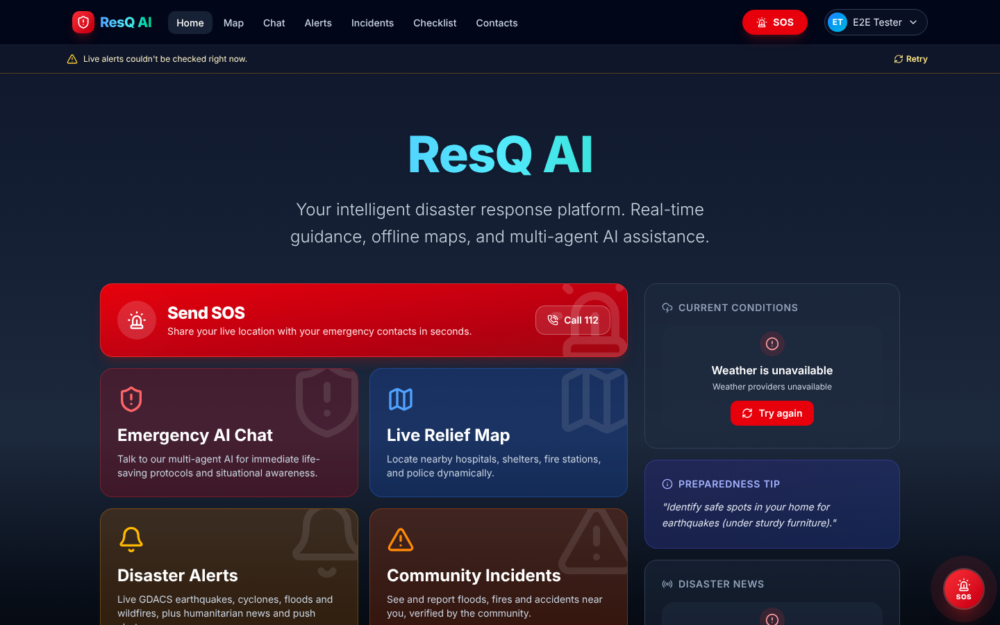 | 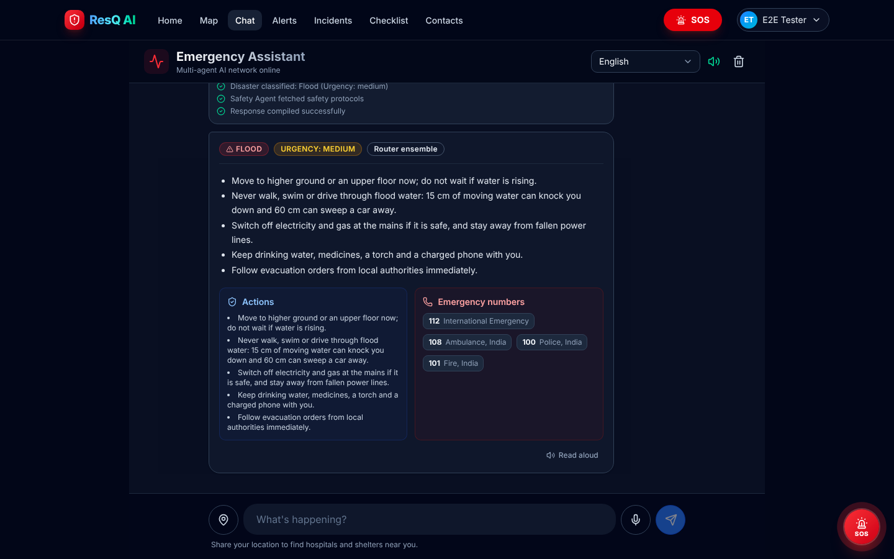 | 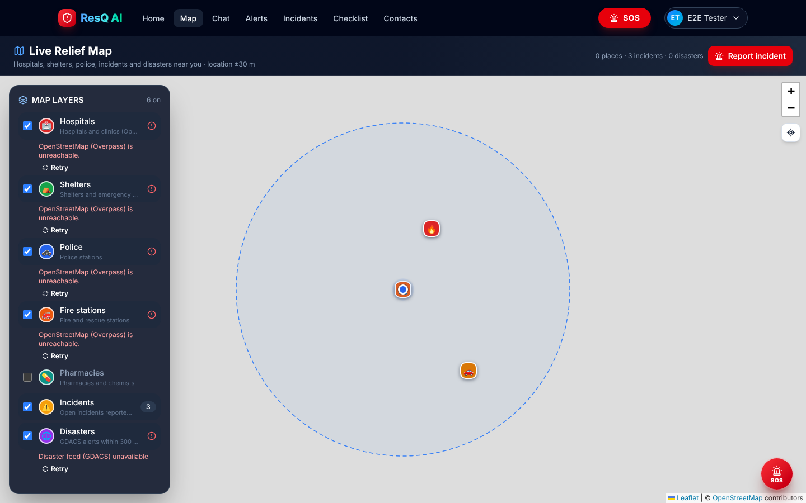 |

| Alerts | Incidents | SOS | Mobile |
|---|---|---|---|
| 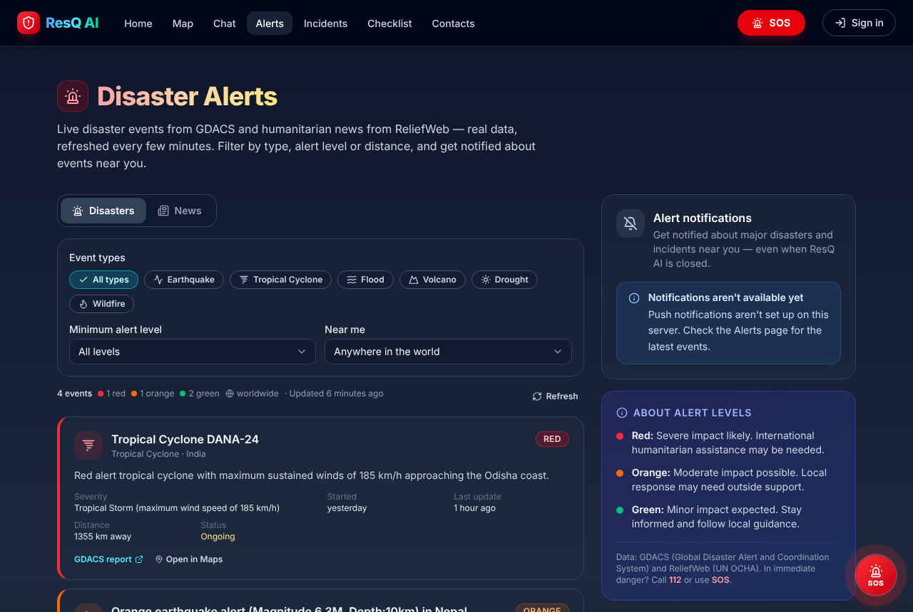 | 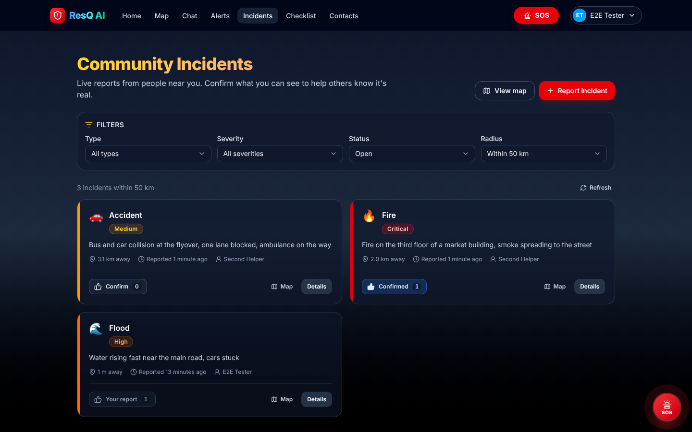 | 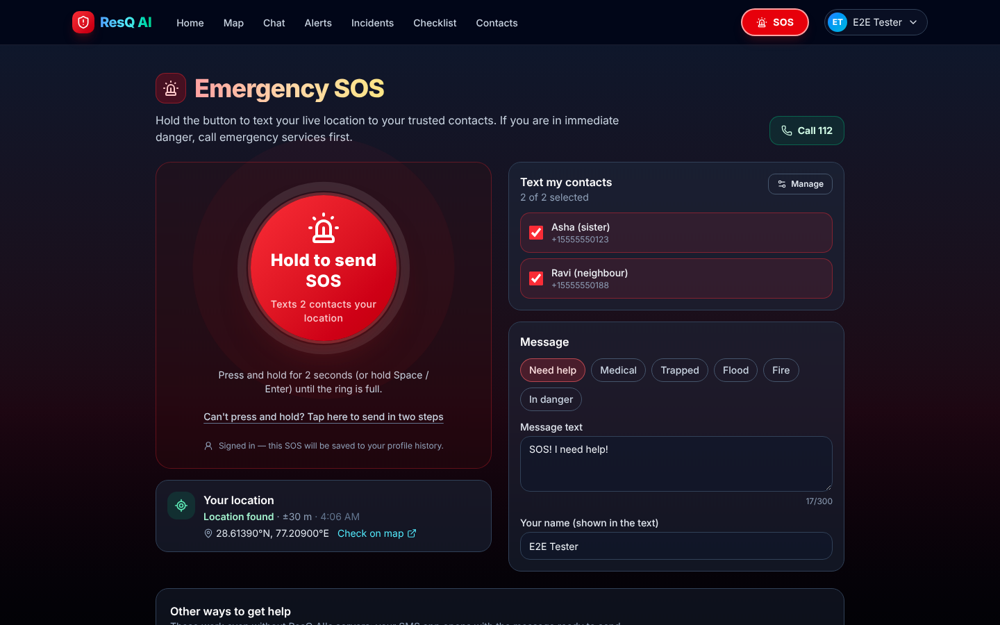 | 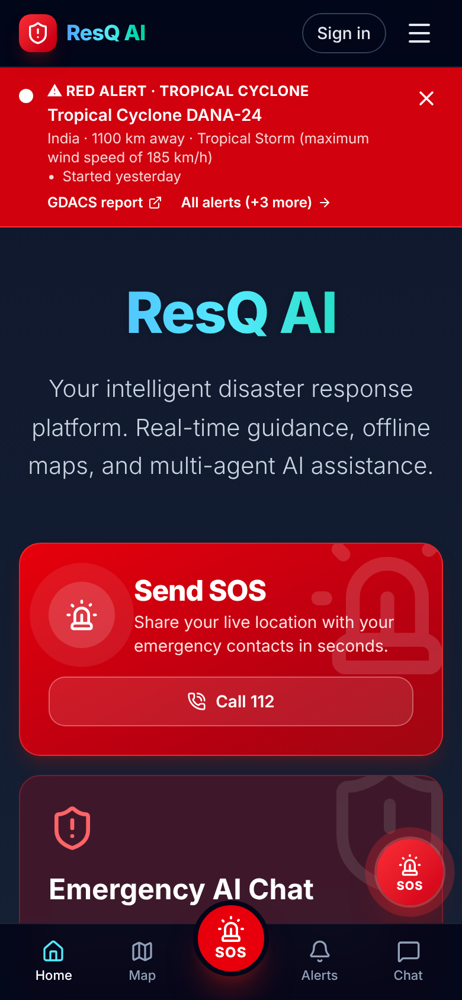 |

| Checklist | Contacts | Demo (earlier UI) |
|---|---|---|
| 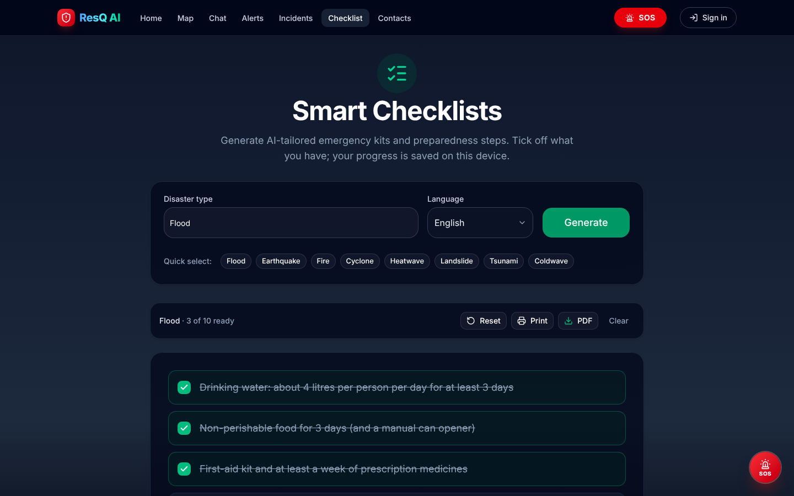 | 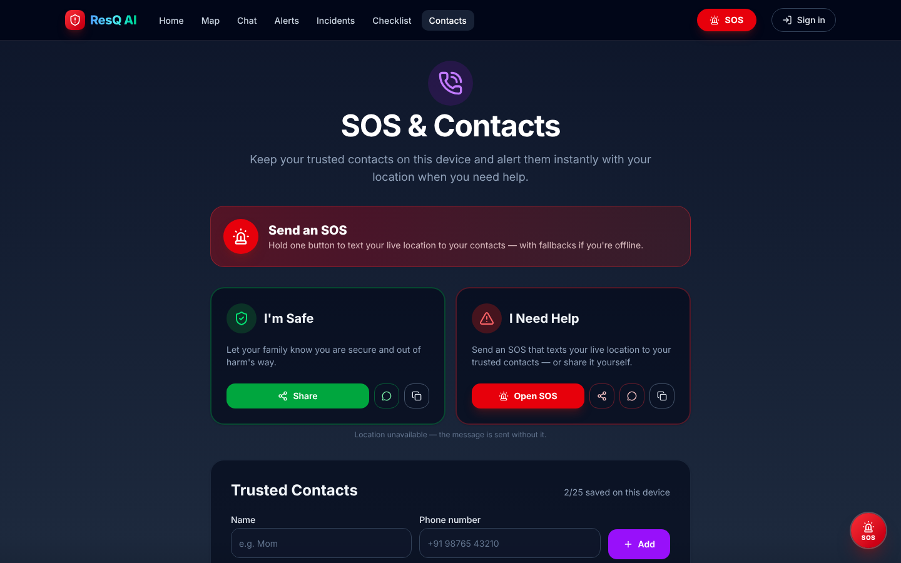 | 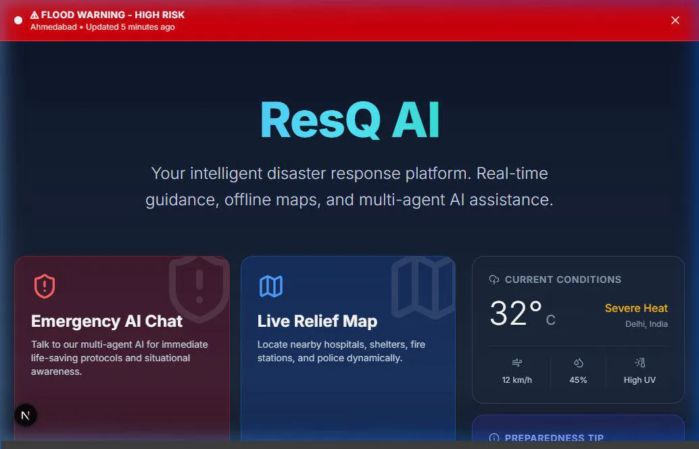 |

The `docs/screenshots/` images were taken from the production Docker images (`docker compose`,
signed in, through the nginx proxy) in an environment without internet access. That is why the
panels fed by live sources (GDACS alerts and news, weather, OpenStreetMap places and map tiles)
show the app's "unavailable" / retry states and the map has no background tiles; in a real
deployment they show the live data. The chat answer is the built-in fallback (no Gemini key), and
the incidents were reported through the running app. The checklist, contacts and mobile captures
come from a production build of the same code (`next build` + `next start`); the checklist is the
built-in flood list and the contacts are sample entries. The animated demo
(`docs/images/demo.webp`, an animated WebP) was recorded with an earlier version of the UI.

---

## Architecture

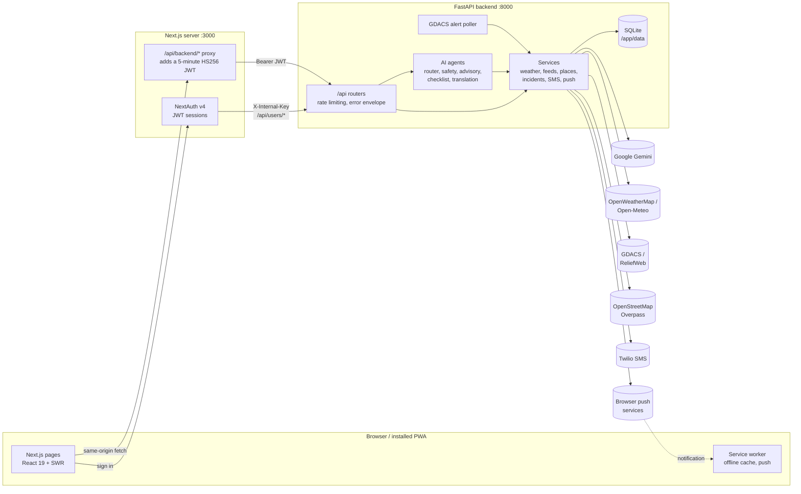

How it fits together:

- **The browser never calls the backend directly.** Every data request goes to the same-origin
  proxy `/api/backend/<path>`. A Next.js route handler forwards it to
  `${BACKEND_URL}/api/<path>` at runtime, so one Docker image works anywhere. No backend URL
  is baked into the browser bundle.
- **Auth:** NextAuth keeps the session in an encrypted JWT cookie. For signed-in users the
  proxy mints a short-lived HS256 token (`iss=resq-frontend`, `aud=resq-backend`, 5 minutes)
  signed with `BACKEND_JWT_SECRET`, and the backend verifies it. Browser cookies and any
  client-sent `Authorization` header are never forwarded.
- **Internal endpoints:** email and password users are stored in the backend. Only the Next.js
  server may call `/api/users/*`, with the shared `X-Internal-Key`. The proxy blocks that path
  for browsers.
- **Backend services** are created once at startup: a shared HTTP client, a TTL cache, the LLM
  service and the weather, feed, places, SMS and push services. They are injected into the
  routes. Data from upstream providers is cached (weather 5 min, feeds 10 min, places 1 h).
- **The background poller** (optional) checks GDACS and pushes new Orange/Red events to the
  subscribers inside their chosen radius. An event is pushed once per alert level, so an
  Orange event that escalates to Red is pushed again.

---

## Quick start

### Option 1: Docker Compose (recommended)

Requirements: Docker with Compose **v2.24 or newer**.

```bash
git clone https://github.com/Mayank-thakur21/resq-ai.git
cd resq-ai
cp .env.example .env
make secrets            # prints NEXTAUTH_SECRET, BACKEND_JWT_SECRET, INTERNAL_API_KEY
# paste the three values into .env (plus any optional API keys), then:
docker compose up --build -d
```

No `make`? Generate each secret with `openssl rand -base64 48`.

- Web app: <http://localhost:3000>
- API docs (Swagger UI): <http://localhost:8000/docs> (published on `127.0.0.1` only)
- Health: <http://localhost:8000/api/health>

Compose waits for the backend to pass its health check before it starts the frontend. Port
3000 is served by a small nginx `proxy` service (`deploy/nginx/default.conf`) in front of
Next.js: it overwrites `X-Forwarded-For` with the real client address, which Next.js trusts
(`TRUSTED_PROXY_HOPS=1`) for per-client rate limits. The frontend container itself is not
published. The SQLite database lives in the `resq-data` volume, so `docker compose down` keeps
your data and `docker compose down -v` deletes it.

### Option 2: Local development

Requirements: Python 3.12+ (3.13 recommended), Node.js 22 (22.22 or newer to run the frontend
tests) and npm 10.

```bash
make install        # backend/.venv with pinned deps + frontend npm ci
make env            # backend/.env and frontend/.env.local from the examples
# set the SAME BACKEND_JWT_SECRET and INTERNAL_API_KEY in backend/.env and
# frontend/.env.local, and a NEXTAUTH_SECRET in frontend/.env.local (make secrets)
make dev            # backend on :8000 and frontend on :3000 (Ctrl+C stops both)
```

The same steps without `make`:

```bash
# Backend
cd backend
python3 -m venv .venv && source .venv/bin/activate
pip install -r requirements-dev.txt
cp .env.example .env
uvicorn app.main:app --reload            # http://127.0.0.1:8000/docs

# Frontend (new terminal)
cd frontend
npm ci
cp .env.example .env.local
npm run dev                              # http://localhost:3000
```

`make help` lists every convenience target (`lint`, `test`, `typecheck`, `build`, `check`,
`up`, `down`, `logs`, `vapid`, `clean`...).

---

## Configuration

Three example files document every variable, each with comments:

| File | Used for |
|---|---|
| [`.env.example`](.env.example) | Docker Compose: copy it to `.env` in the repo root. It holds the shared secrets and frontend settings, and serves as the backend's `env_file`. |
| [`backend/.env.example`](backend/.env.example) | Running the backend locally: copy it to `backend/.env`. |
| [`frontend/.env.example`](frontend/.env.example) | Running the frontend locally: copy it to `frontend/.env.local`. |

Empty values mean "not configured". The matching feature switches off or falls back, and
`GET /api/health` reports which integrations are active.

### Shared secrets (required)

| Variable | Used by | Description |
|---|---|---|
| `NEXTAUTH_SECRET` | frontend | Encrypts and signs NextAuth session cookies. Required in production. |
| `BACKEND_JWT_SECRET` | frontend + backend | HS256 secret: the proxy signs user tokens and the backend verifies them. **Must be identical in both.** If empty on the backend, endpoints that need sign-in return `503 not_configured`. |
| `INTERNAL_API_KEY` | frontend + backend | Shared `X-Internal-Key` for `/api/users/*` (register / verify). It also authenticates the client address the Next.js server reports in `X-ResQ-Client-IP` (per-client rate limits). **Must be identical in both.** If empty, email and password sign-in is disabled (`503`) and anonymous rate limits fall back to the proxy's own address. |

### Frontend (Next.js)

| Variable | Default | Description |
|---|---|---|
| `BACKEND_URL` | `http://localhost:8000` | Backend base URL as seen by the Next.js server (read at runtime). Compose sets `http://backend:8000`. |
| `NEXTAUTH_URL` | `http://localhost:3000` | Public URL of the web app (OAuth callbacks, redirects, metadata links). |
| `TRUSTED_PROXY_HOPS` | `0` | Reverse proxies in front of Next.js whose `X-Forwarded-For` entry is trusted; the client address is the entry this many hops from the right. `0` = Next.js is reached directly (a client can then forge its address: fine for local development, never for a public deployment). Compose sets `1` for its nginx proxy (root `.env`: `FRONTEND_TRUSTED_PROXY_HOPS`). |
| `GITHUB_ID` / `GITHUB_SECRET` | empty | Enables "Continue with GitHub" when both are set. |
| `GOOGLE_CLIENT_ID` / `GOOGLE_CLIENT_SECRET` | empty | Enables "Continue with Google" when both are set. |
| `NEXT_PUBLIC_DEFAULT_LAT` / `NEXT_PUBLIC_DEFAULT_LON` | `28.6139` / `77.2090` | Fallback map centre when the location is unknown (New Delhi). Inlined at **build time**; Compose passes them as build args. |
| `NEXT_PUBLIC_ENABLE_SW_IN_DEV` | `false` | `true` registers the service worker under `npm run dev` as well. It is always registered in production. |

### Backend (FastAPI)

| Variable | Default | Description |
|---|---|---|
| `APP_ENV` | `development` | `development`, `production` or `test`. The Docker image defaults to `production`. |
| `LOG_LEVEL` | `INFO` | `CRITICAL`, `ERROR`, `WARNING`, `INFO` or `DEBUG`. |
| `LOG_JSON` | `false` | One JSON object per log line (with `request_id`) for log shippers. |
| `CORS_ORIGINS` | `http://localhost:3000` | Comma-separated browser origins. Only matters for clients other than the web app, which uses its proxy. |
| `DATABASE_URL` | `sqlite+aiosqlite:///./data/resq.db` | SQLAlchemy async URL. The parent directory is created automatically. Compose fixes it to `/app/data/resq.db` on the volume. |
| `GEMINI_API_KEY` | empty | Google Gemini key ([get one](https://aistudio.google.com/apikey)). Without it the agents use deterministic fallbacks. |
| `GEMINI_MODEL` | `gemini-2.5-flash` | Gemini model id. |
| `OPENWEATHER_API_KEY` | empty | OpenWeatherMap key. Without it the backend uses Open-Meteo (free, keyless). |
| `OPENWEATHER_ONECALL_ENABLED` | `false` | Fetch official weather alerts from One Call 3.0 (needs that OWM subscription). |
| `RELIEFWEB_APPNAME` | empty | Approved ReliefWeb appname. Without it, news comes from GDACS only. |
| `TWILIO_ACCOUNT_SID` / `TWILIO_AUTH_TOKEN` | empty | Twilio credentials for SOS SMS. |
| `TWILIO_FROM_NUMBER` | empty | Sender number in E.164 format (`+15551234567`). |
| `TWILIO_MESSAGING_SERVICE_SID` | empty | Messaging Service (`MG...`), used instead of the from-number when set. |
| `VAPID_PUBLIC_KEY` / `VAPID_PRIVATE_KEY` | empty | Web-push key pair (raw base64url). Both are needed to enable push. |
| `VAPID_SUBJECT` | `mailto:admin@example.com` | Contact URI sent to push services. |
| `RATE_LIMIT_DEFAULT` | `120/minute` | Default limit per client and route. Several limits can be joined with `;`. |
| `SOS_RATE_LIMIT` | `5/minute` | Limit for `POST /api/sos`. |
| `INCIDENT_RATE_LIMIT` | `5/hour;20/day` | Incident reports per signed-in user. |
| `TRUSTED_PROXY_HOPS` | `0` | Reverse proxies directly in front of the **backend** whose `X-Forwarded-For` entry is trusted. `0` ignores the header. Browsers relayed by the Next.js proxy are identified by `X-ResQ-Client-IP` (accepted only together with a valid `X-Internal-Key`), so the standard setup needs `0`. |
| `SOS_SMS_PER_NUMBER_LIMIT` | `3/hour;10/day` | Twilio SOS SMS per destination number (keyed hash). Numbers over budget are reported in `sms.failed` and covered by `fallback_sms_uri`. |
| `SOS_SMS_PER_CLIENT_LIMIT` | `30/hour;100/day` | Twilio SOS SMS per caller (signed-in user id, else client address with IPv6 by `/64`), so one caller cannot use up the shared budgets with made-up numbers. |
| `SOS_SMS_PER_ADDRESS_LIMIT` | `60/hour;200/day` | Twilio SOS SMS per client address (IPv6 by `/64`) for everyone sending from it, signed in or not, so many cheap accounts created on one address share one budget. Signed-in requests count here only when the Next.js server reports the address. People behind one shared address (shelter Wi-Fi, carrier NAT) share it as well. |
| `SOS_SMS_PER_PREFIX_LIMIT` | `150/hour;600/day` | Twilio SOS SMS per IPv6 `/48` network (all its `/64` addresses together, signed in or not), so one customer rotating through the `/64` networks of its `/48` or `/56` shares one budget. Higher than the per-address budget because a `/48` can also be a carrier pool shared by many people. IPv4 callers have no wider bucket (the per-address budget applies). |
| `SOS_SMS_ANONYMOUS_LIMIT` | `200/hour;1000/day` | Twilio SOS SMS for all anonymous callers together (counted inside the global budget), so anonymous traffic can never take more than this part of it. |
| `SOS_SMS_NEW_CALLER_LIMIT` | `400/hour;2400/day` | Twilio SOS SMS for all new callers together: anonymous callers and email/password accounts younger than `SOS_SMS_ESTABLISHED_ACCOUNT_HOURS`. Counted inside the global budget and kept below it, so the difference (100/hour and 600/day by default) stays reserved for established accounts and freshly registered accounts, however many, cannot use the whole budget. Set it equal to `SOS_SMS_GLOBAL_LIMIT` to drop the reserve. |
| `SOS_SMS_ESTABLISHED_ACCOUNT_HOURS` | `24` | Account age (hours since registration, 0 to 8760) from which an email/password account may use the reserved part of the global budget. OAuth sign-ins count as established (the provider vetted the account). `0` treats every signed-in caller as established. If the age lookup takes longer than 1 s, the SOS goes on with the caller treated as new. |
| `SOS_SMS_GLOBAL_LIMIT` | `500/hour;3000/day` | Twilio SOS SMS for the whole server (caps the Twilio bill whatever callers do). Numbers Twilio rejects are refunded. Established accounts spread over many addresses can still use it up; contacts over budget get the native-SMS fallback. |
| `SOS_SMS_REQUIRE_AUTH` | `false` | `true` sends Twilio SMS only for signed-in users; anonymous callers get the native-SMS fallback. |
| `ALERT_POLLER_ENABLED` | `false` | Start the background GDACS poller that pushes Orange/Red alerts (needs VAPID keys). The example env files and Compose turn it on. When off, `/api/push/vapid-public-key` reports `disaster_alerts: false` and the app hides that topic. |
| `ALERT_POLL_INTERVAL_SECONDS` | `600` | Poll interval (30 to 86400). |
| `INCIDENT_VERIFY_THRESHOLD` | `3` | Upvotes needed to mark an incident as verified. |
| `HTTP_TIMEOUT_SECONDS` | `10` | Timeout for upstream data providers. |
| `WEATHER_CACHE_TTL` / `FEED_CACHE_TTL` / `PLACES_CACHE_TTL` | `300` / `600` / `3600` | Cache lifetimes in seconds. |
| `OVERPASS_URL` | `https://overpass-api.de/api/interpreter` | Overpass API endpoint for nearby places. The public instance allows ~2 concurrent queries per server IP; multi-user deployments should use a self-hosted or commercial instance. |
| `OVERPASS_MAX_CONCURRENCY` | `2` | Concurrent Overpass queries per backend process (raise it to what your `OVERPASS_URL` allows). |

`FORWARDED_ALLOW_IPS` (read by uvicorn, default `127.0.0.1`) controls which proxies are
trusted for `X-Forwarded-Proto` / `X-Forwarded-For` when the container runs with
`--proxy-headers`.

---

## API reference

Interactive docs are served by the backend at `/docs` (Swagger UI) and `/redoc`. Every path
below sits under `/api` on the backend. From the browser, call it through the proxy as
`/api/backend/<path>`, e.g. `/api/backend/weather?lat=..&lon=..`.

**Auth column:** *none* = public; *optional* = a signed-in user is recorded when present;
*required* = Bearer JWT (the proxy adds it for signed-in users), otherwise `401`;
*internal* = `X-Internal-Key`, called by the Next.js server only.

### Health and meta

| Method | Path | Auth | Description |
|---|---|---|---|
| GET | `/api/health` | none | `{"status":"ok","version":"2.0.0","services":{"database":"ok","gemini":bool,"openweathermap":bool,"reliefweb":bool,"twilio":bool,"push":bool,"auth":bool}}`. Returns **503** with `status:"degraded"` when the database is down. Not rate limited. |
| GET | `/` | none | `{"name":"ResQ AI API","version":"2.0.0","docs":"/docs"}` (outside `/api`). |

### AI chat and tools

| Method | Path | Auth | Description |
|---|---|---|---|
| POST | `/api/chat` | none | `{message (1-2000), language="en", location?: {lat, lon}}` returns `{response, agent_used, urgency_level, detected_disaster, advisory, recommended_actions[], emergency_numbers[], steps_taken[], data{}}`. Without Gemini a keyword classifier picks the built-in protocol (it recognises everyday descriptions such as "water entered my house" or "my grandmother fell"); a message it does not recognise still gets basic safety steps (call the local emergency number, move to safety, share your location) in `response` and `recommended_actions`. |
| POST | `/api/classify` | none | `{message}` returns `{disaster_type, urgency: low/medium/high, intent}`. |
| POST | `/api/checklist` | none | `{disaster_type, language="en"}` returns `{"checklist": [str]}`. |
| POST | `/api/translate` | none | `{text, target_language}` returns `{"translated_text": str}`. |
| GET | `/api/advisories?lat&lon&language=en` | none | AI weather safety advisory: `{"advisories": str}`. |

### Weather

| Method | Path | Auth | Description |
|---|---|---|---|
| GET | `/api/weather?lat&lon` | none | `{weather{temperature, feels_like, humidity, wind_speed_kmh, description, icon, weather_code, city, country, is_day, observed_at, source}, forecast[{time, temperature, description, icon, precipitation_probability}], alerts[{event, description, sender, start, end, severity}], hazards[{type, severity, message}]}`. `source` is `openweathermap` or `open-meteo` (OpenWeatherMap: 8 three-hourly forecast steps; Open-Meteo: up to 24 hourly steps, `city`/`country` null). Upstream calls use coordinates rounded to 2 decimals (~1 km) for privacy and caching. `alerts` need `OPENWEATHER_ONECALL_ENABLED=true` and a separate One Call 3.0 subscription (a 401/403 is logged once, then alerts are skipped for an hour). Returns `502` if both providers fail and `422` for out-of-range coordinates. |

### Disaster alerts and news

| Method | Path | Auth | Description |
|---|---|---|---|
| GET | `/api/alerts/disasters?lat&lon&radius_km&types=EQ,TC&min_level=green&limit=50` | none | GDACS events `{events[{id, source, event_type, event_type_label, title, description, alert_level, severity_text, country, lat, lon, from_date, to_date, is_current, url, distance_km}], updated_at}`. Types: EQ, TC, FL, VO, DR, WF. With `lat`/`lon`, events are sorted by level, then distance (otherwise level, then most recent activity). `radius_km` (needs `lat`/`lon`) filters by distance. While GDACS is down the last good copy (up to 6 h old) is served; `updated_at` is when it was fetched. |
| GET | `/api/alerts/news?limit=20&query=&country=IND` | none | `{items[{id, source, title, url, published_at, summary, countries[], disaster_types[], source_name}], sources[], updated_at}`. `country` is an ISO3 code. ReliefWeb is used only with an approved `RELIEFWEB_APPNAME` (a 401/403 is logged as an error); otherwise, or when it fails, items are derived from GDACS events. `sources` lists the providers the response is based on. |

### Places (OpenStreetMap)

| Method | Path | Auth | Description |
|---|---|---|---|
| GET | `/api/places?lat&lon&type=hospital&radius=5000&limit=100` | none | `{places[{id, name, type, lat, lon, distance_km, address, phone}]}`, nearest first. `type` is `hospital`, `shelter`, `police`, `fire_station` or `pharmacy`. The radius is clamped to 500-20000 m. One Overpass query per map view (a ~1.1 km cell and a radius tier of 1/2/5/10/20 km) returns every place type and is cached for `PLACES_CACHE_TTL`, so all layers, nearby users and any radius up to the tier share it; distances are measured from the exact point. Returns `502 upstream_error` if Overpass fails (never an empty list), also for a type Overpass did not get to before running out of time (a partial answer serves only the types it searched completely). |
| GET | `/api/hospitals`, `/api/shelters`, `/api/police`, `/api/fire-stations` (`?lat&lon`) | none | Legacy shortcuts with the same item shape: `{"hospitals": [...]}`, `{"shelters": [...]}`, `{"police": [...]}`, `{"fire_stations": [...]}`. |

### SOS

| Method | Path | Auth | Description |
|---|---|---|---|
| POST | `/api/sos` | optional | `{lat, lon, accuracy_m?, message (1-300, default "SOS! I need help!"), contact_numbers[0-10 E.164], user_name?}` returns `{id, timestamp, maps_link, message, sms{configured, sent[{to, sid, status}], failed[{to, error}]}, fallback_sms_uri}`. Numbers are normalised (spaces/dashes removed) and deduplicated. Numbers in the response are masked. Rate limit: `SOS_RATE_LIMIT`. |
| GET | `/api/sos/history` | required | The user's own SOS events, newest first (max 50): `{events[{id, timestamp, lat, lon, message, contacts_count, sms_sent, sms_failed}]}`. |

SMS body: `🆘 SOS from {name}: {message} | Location: https://maps.google.com/?q=<lat>,<lon> | {UTC time}` (at most 320 characters).

### Incidents

| Method | Path | Auth | Description |
|---|---|---|---|
| POST | `/api/incidents` | required | `{lat, lon, disaster_type, severity, description (10-1000), image_url?}` returns **201** with an Incident and notifies nearby subscribers of the `incidents` push topic (the reporter's own devices are skipped). Limit: `INCIDENT_RATE_LIMIT` per user. Pushes are throttled: at most 3 per reporter per hour, and one incident notification per device per 10 minutes. |
| GET | `/api/incidents?lat&lon&radius_km=50&status=open&type=&limit=100` | optional | `{incidents[Incident]}`, newest first. `distance_km` is included when `lat`/`lon` are given. `status` is `open` (default), `resolved` or `all`. |
| GET | `/api/incidents/{id}` | optional | One Incident, or `404 not_found`. |
| POST | `/api/incidents/{id}/upvote` | required | Upvote (idempotent per user). Returns the Incident. Reporters cannot upvote their own report (`403 forbidden`). `verified` becomes true at `INCIDENT_VERIFY_THRESHOLD` upvotes. |
| PATCH | `/api/incidents/{id}` | required | `{status: "open" or "resolved"}`. Only the reporter may do this; others get `403`. |

Incident: `{id, created_at, updated_at, lat, lon, disaster_type, severity, description, image_url, status, reporter{id, name}, upvotes, verified, upvoted_by_me, distance_km}`.
`disaster_type` is one of `flood`, `earthquake`, `fire`, `cyclone`, `landslide`, `drought`,
`heatwave`, `tsunami`, `storm`, `accident`, `medical` or `other`. `severity` is `low`,
`medium`, `high` or `critical`.

### Push notifications

| Method | Path | Auth | Description |
|---|---|---|---|
| GET | `/api/push/vapid-public-key` | none | `{"enabled": bool, "public_key": str or null, "disaster_alerts": bool}`. `disaster_alerts` is true only when the GDACS alert poller runs. |
| POST | `/api/push/subscribe` | optional | `{subscription{endpoint, keys{p256dh, auth}}, lat?, lon?, radius_km (1-500, default 50), topics: ["incidents","disasters"]}` returns `{id, radius_km, topics}`. Upserts by endpoint. `endpoint` must be an `https` URL of a browser push service (FCM, Mozilla, Windows WNS, Apple; no IP literals, ports or user-info) and the keys must be a real P-256 key / 16-byte secret, otherwise `422`. Limit: 10/minute per client. Returns `503 not_configured` when push is disabled. |
| POST | `/api/push/unsubscribe` | none | `{endpoint}` returns `{"ok": true}` (idempotent). |
| POST | `/api/push/unlink` | none | `{endpoint}` detaches the subscription from its account (it keeps getting location alerts anonymously) and returns `{"ok": true}`. The app calls it on sign-out. |
| POST | `/api/push/test` | required | Sends a test notification to the user's subscriptions and returns `{"sent": int}`. Limit: 5/minute. |

### Users (internal)

| Method | Path | Auth | Description |
|---|---|---|---|
| POST | `/api/users/register` | internal | `{email, password (8-128), name (1-80)}` returns **201** `{id, email, name}`, or `409 conflict` if the email is taken. Limit: 5/minute and 20/hour per end client, and 20/minute and 200/hour per IPv6 `/48` (all its `/64` clients together). |
| POST | `/api/users/verify` | internal | `{email, password}` returns `{id, email, name}`, or one generic `401` for bad credentials. Not subject to the per-IP default limit (every call comes from the Next.js server). Failed attempts are limited to 5/minute and 20/hour per end client and account, 30/minute per end client and 100/hour per account; then `429 rate_limited`. Each attempt reserves its slot before the password check (concurrent guesses cannot slip past the limit) and gets it back when the password is correct; a successful sign-in clears that client's counter for the account. When the per-account bucket is full, clients that recently signed in to the account successfully (the last 8 per account, for 14 days; at most 50,000 accounts are remembered, the one with the oldest successful sign-in dropped first) still get in, and clients with fewer than 2 failures of their own may try through a small per-account overflow bucket (20/hour), so someone else's guessing does not lock the owner out, while rotating networks (an IPv6 `/48` holds 65,536 `/64`s) cannot multiply the account's budget. Every attempt, successful or not, also counts against 30/minute and 600/hour per end client and 120/minute and 2,400/hour per IPv6 `/48` (correct passwords cost a bcrypt check too), and successful sign-ins are capped at 30/hour per account (only someone who knows the password can use that up). A client may have at most 4 sign-ins in flight, an IPv6 `/48` at most 16. `503 service_busy` when the bcrypt queue is full; a client's first 3 bcrypt jobs per minute may use 8 slots of it that busier clients cannot take, provided its `/48` has not run more than 6 in that minute. |

The browser cannot reach these through the proxy (`404`). Use the Next.js routes instead:
`POST /api/register` and the NextAuth credentials sign-in.

### Errors and rate limits

Every error uses one envelope:

```json
{ "error": { "code": "validation_error", "message": "query.lat: Input should be less than or equal to 90", "request_id": "6f1c..." } }
```

| HTTP | `code` |
|---|---|
| 401 | `unauthorized` |
| 403 | `forbidden` |
| 404 | `not_found` |
| 409 | `conflict` |
| 422 | `validation_error`, `invalid_input` |
| 429 | `rate_limited` (with `Retry-After` in seconds) |
| 500 | `internal_error` (details are logged, never returned) |
| 502 | `upstream_error`; from the proxy: `backend_unreachable` |
| 503 | `not_configured` |
| 504 | `backend_timeout` (proxy) |

Every response carries `X-Request-ID` (an incoming one is honoured), which you can use to find
the matching log line. Rate-limited routes add `X-RateLimit-Limit`, `X-RateLimit-Remaining`
and `X-RateLimit-Reset` (epoch seconds). Clients are keyed by user id when signed in,
otherwise by IP.

---

## Authentication setup

1. **Secrets:** generate `NEXTAUTH_SECRET`, `BACKEND_JWT_SECRET` and `INTERNAL_API_KEY`
   (`make secrets`). Give the frontend and the backend the **same** `BACKEND_JWT_SECRET` and
   `INTERNAL_API_KEY`. Compose does this for you from the root `.env`.
2. **`NEXTAUTH_URL`:** set it to the public URL of the web app, e.g.
   `https://resq.example.org`.
3. **Email and password:** works out of the box. `/register` calls the Next.js route
   `POST /api/register`, which calls the backend's internal `/api/users/register`. Passwords
   are pre-hashed with HMAC-SHA256 and then hashed with bcrypt (cost 12, about 0.25 s per
   register/verify, in a worker thread), so passwords longer than bcrypt's 72-byte limit are
   safe. Too many failed sign-ins for one email show "Too many sign-in attempts" (`429`).
4. **GitHub (optional):** go to GitHub, then Settings, Developer settings, OAuth Apps, New
   OAuth App.
   - Homepage URL: `NEXTAUTH_URL`
   - Authorization callback URL: `<NEXTAUTH_URL>/api/auth/callback/github`
   - Set `GITHUB_ID` and `GITHUB_SECRET`.
5. **Google (optional):** go to the Google Cloud Console, then APIs & Services, Credentials,
   Create credentials, OAuth client ID (Web application).
   - Authorised JavaScript origin: `NEXTAUTH_URL`
   - Authorised redirect URI: `<NEXTAUTH_URL>/api/auth/callback/google`
   - Set `GOOGLE_CLIENT_ID` and `GOOGLE_CLIENT_SECRET`.

The OAuth buttons appear only when both values of a provider are set. OAuth user ids are
namespaced (`github:<id>`, `google:<id>`). `/profile` and `/incidents/new` require sign-in and
redirect to `/login?callbackUrl=...`. The backend enforces auth again on every protected
endpoint.

---

## PWA and push notifications

**PWA.** The app serves a manifest at `/manifest.webmanifest`, with SOS, Map, Chat and Alerts
shortcuts and maskable icons. A hand-written service worker (`frontend/public/sw.js`) gives:

- an `/offline` page with emergency numbers that work without a network;
- offline-critical pages warmed at install, even if never visited: `/offline`, `/sos`,
  `/contacts`, `/map` and `/incidents` (static shells that read their query on the client),
  including the lazily loaded Leaflet map chunks (listed at build time by
  `/offline-assets.json`). They live in an untrimmed per-build cache, so browsing can never
  evict them;
- network-first caching of recent weather, alerts, incidents and places responses, also used
  when the server answers `5xx` (backend down or restarting). Saved copies carry
  `X-ResQ-Offline: 1` / `X-ResQ-Cached-At`, and every widget that shows them (weather, alert
  banner, disaster list and news, incidents and incident details, map layers) says "Showing
  saved data from …" so offline data never looks live; incident actions that need the server
  are disabled on a saved copy;
- location-tolerant offline lookups: a new GPS fix rarely matches the saved URL exactly, so the
  saved copy for the same filters whose location is nearest (within a quarter of the query
  radius, 1-10 km; 5 km for weather) is used and labelled with its distance. When locating
  fails offline, pages use the last known fix (`resq_last_fix`) instead of the default
  location;
- stale-while-revalidate caching of OpenStreetMap tiles;
- an "Update available" toast when a new version is deployed.

The service worker is registered in production builds. Set `NEXT_PUBLIC_ENABLE_SW_IN_DEV=true`
to test it under `npm run dev`; it then serves `/_next/static` cache-first, so clear the site
data after code changes. Installing, push and geolocation need a secure context: HTTPS,
or `http://localhost` for development.

- **Deploys:** the worker is registered as `/sw.js?v=<build id>` (`NEXT_PUBLIC_RESQ_BUILD_ID`,
  set by `next.config.ts`; override with `RESQ_BUILD_ID`, e.g. the git SHA). Every build
  therefore installs a new worker that re-warms the offline pages and drops the previous
  build's caches; API data and map tiles survive deploys (`DATA_CACHE_VERSION` in
  `public/sw.js`).
- **Cached API responses** carry `X-ResQ-Offline: 1` and `X-ResQ-Cached-At` (plus
  `X-ResQ-Cached-Distance-M` for a nearest-location match and `X-ResQ-Offline-Reason:
  server-error` when they replace a `5xx`). Uncached API requests while offline get a `503`
  JSON error with code `network_error`. Navigations answered `5xx` fall back to the saved page,
  and for `502`-`504` without one to the offline page.
- **Sign-out** clears the service worker's API cache (from the page itself, so it also works
  after a hard reload, and responses still in flight are not stored afterwards), the tab's
  chat transcript and incident draft, the last location and the remembered SOS name, and
  unlinks this device's push subscription from the account (`lib/sign-out.ts`); signing in
  re-links it, so test notifications reach the device that shows "On". The data is cleared
  twice: right away, and again once the sign-out request has deleted the session cookie, so
  nothing fetched with the old session in between (a periodic refresh, another tab) stays
  cached. The app's data refreshes are paused meanwhile, and the signed-out page is a full
  page load. When a different account signs in without a sign-out in between (e.g. after the
  session expired), the previous account's cached data is cleared the same way
  (`components/SessionDataGuard.tsx`).
- **Icons** are generated from SVG artwork with `npm run icons`
  (`frontend/scripts/generate-icons.mjs`, uses the `sharp` that ships with Next.js). The script
  writes every PWA icon, the favicon and `app/favicon.ico`, and verifies their sizes.

**Enable web push:**

1. Generate a VAPID key pair, using any one of:

   ```bash
   npx web-push generate-vapid-keys
   make vapid
   python -c "from py_vapid import Vapid01; from py_vapid.utils import b64urlencode; from cryptography.hazmat.primitives import serialization as s; v = Vapid01(); v.generate_keys(); print('VAPID_PUBLIC_KEY=' + b64urlencode(v.public_key.public_bytes(s.Encoding.X962, s.PublicFormat.UncompressedPoint))); print('VAPID_PRIVATE_KEY=' + b64urlencode(v.private_key.private_numbers().private_value.to_bytes(32, 'big')))"
   ```

   The `python` command must run where the backend dependencies are installed.
   `VAPID_PRIVATE_KEY` must be the raw base64url key these commands print (base64 DER also
   works). A malformed key logs an error and disables push (health then reports
   `"push": false`).
2. Set `VAPID_PUBLIC_KEY`, `VAPID_PRIVATE_KEY` and `VAPID_SUBJECT` (a `mailto:` or `https:`
   contact) **on the backend**. The frontend reads the public key from
   `/api/push/vapid-public-key`, so it needs no extra variable.
3. Open **Alerts** (or **Profile**), enable notifications, then pick a radius and topics
   (`incidents`, `disasters`). Use **Send test notification** on the profile page to check
   delivery.
4. Keep `ALERT_POLLER_ENABLED=true` (the default in the example env files and Compose) to push
   new GDACS Orange/Red events near subscribers. With it off the app hides the "Disaster
   alerts" topic. Subscribers without a location receive only Red alerts. New community incidents
   are pushed to subscribers within their radius. The poller first runs 15 s after startup,
   then every `ALERT_POLL_INTERVAL_SECONDS`; it pushes at most 20 events per cycle (most severe
   first), skips events with no activity for over 3 days, and pushes again when an event goes
   from Orange to Red (never on a downgrade). Each event/level is claimed in the database
   before sending, so several workers never push the same event twice.

Notification clicks open `/incidents?focus=<id>` (highlights the incident) or
`/alerts?event=<GDACS id>` (pins and highlights the event on the Disasters tab).

Subscriptions that push services report as gone (`404`/`410`) are deleted automatically.
Keep the VAPID private key secret. Changing the key pair makes every existing browser
subscription invalid, so users must enable notifications again.

---

## SOS and Twilio setup

Without Twilio the SOS flow still works. The response's `fallback_sms_uri` opens the phone's
SMS app with every contact and the message filled in, and the page offers "Share location" and
"Call 112". To send SMS automatically from the server:

1. Create a [Twilio](https://www.twilio.com) account and copy the **Account SID** and **Auth
   Token** from the console.
2. Buy an SMS-capable number, or create a **Messaging Service** (`MG...`) for better
   deliverability and international sender support.
3. Set `TWILIO_ACCOUNT_SID`, `TWILIO_AUTH_TOKEN` and either `TWILIO_FROM_NUMBER` or
   `TWILIO_MESSAGING_SERVICE_SID`. `GET /api/health` then reports `"twilio": true`.
4. Under Messaging, Settings, Geo permissions, enable the countries your contacts are in.
   Trial accounts can only send to verified numbers.

Contacts are stored on the device (`localStorage`) and must be in E.164 format (for example
`+919876543210`). The SOS page shows a hint for numbers without a country code. Each number is
sent separately, and failures are reported per number. Phone numbers are masked in logs and API
responses. SOS audit rows store only counts and a keyed hash of the client IP, never phone
numbers.

---

## Testing and quality gates

CI ([`.github/workflows/ci.yml`](.github/workflows/ci.yml)) runs on every push and pull request:

| Job | Steps |
|---|---|
| backend (Python 3.12 and 3.13) | `ruff check .`, `ruff format --check .`, `pytest -q` |
| frontend (Node 22) | `npm ci`, `npm run lint`, `npm run typecheck`, `npm test`, `npm run build` (dummy secrets) |
| docker (after both pass) | Builds both images (no push) and smoke-tests them with `docker compose up --wait` |

Run the same gates locally:

```bash
make check                 # everything below
make backend-lint backend-test
make frontend-lint typecheck frontend-test build

# or by hand
cd backend && ruff check . && ruff format --check . && pytest -q
cd frontend && npm run lint && npm run typecheck && npm test && npm run build
```

- **Backend tests** (pytest, pytest-asyncio, respx) need **no network**. The test fixtures
  block real sockets, so every upstream call (GDACS, ReliefWeb, OpenWeatherMap, Open-Meteo,
  Overpass, Gemini, Twilio, push) is mocked. Each test gets a fresh temporary SQLite database,
  real throw-away VAPID keys and a reset rate limiter.
- **Frontend tests** (Vitest, Testing Library, jsdom) cover the API client, the proxy route,
  the backend token, auth, the error boundary, the pages and the components. `npm run
  test:watch` reruns them on change.

---

## Project structure

```
resq-ai/
├── backend/                     FastAPI service (Python package "app")
│   ├── app/
│   │   ├── main.py              create_app() factory and lifespan (services on app.state)
│   │   ├── core/                settings, logging, errors, security (JWT), rate limit, middleware
│   │   ├── db/                  async SQLAlchemy engine/session and models
│   │   ├── schemas/             Pydantic request/response models (the API contract)
│   │   ├── services/            http, cache, geo, llm, weather, disaster_feed, places,
│   │   │                        sms, push, users, incidents, alert_poller
│   │   ├── agents/              router, safety, advisory, checklist, translation agents
│   │   └── api/                 /api router, dependencies and one module per feature
│   ├── tests/                   pytest suite (network blocked, respx mocks)
│   ├── requirements.txt         pinned runtime dependencies
│   ├── requirements-dev.txt     + pytest, respx, ruff
│   ├── pyproject.toml           ruff and pytest configuration
│   ├── Dockerfile
│   └── .env.example
├── frontend/                    Next.js 15 App Router (React 19, TypeScript, Tailwind 4)
│   ├── app/                     pages: / map chat alerts incidents sos checklist contacts
│   │   │                        profile login register offline about contact privacy
│   │   └── api/                 backend proxy, NextAuth, registration route handlers
│   ├── components/              Navbar, WeatherCard, AlertBanner, IncidentCard, SOSFab,
│   │                            PushToggle, PwaRegister, InstallPrompt, map/, ui/ ...
│   ├── lib/                     api client, types, auth, backend token, geo, push, contacts
│   ├── public/                  sw.js and icons/
│   ├── scripts/                 generate-icons.mjs (npm run icons)
│   ├── middleware.ts            protects /profile and /incidents/new
│   ├── Dockerfile
│   └── .env.example
├── docs/                        images/ and screenshots/
├── .github/workflows/ci.yml
├── deploy/nginx/default.conf    reverse proxy in front of Next.js (Compose "proxy")
├── docker-compose.yml
├── Makefile
├── .env.example                 configuration for docker compose
├── PROJECT.md                   original architecture notes
└── README.md
```

### Deep links and data on the device

| Link | Effect |
|---|---|
| `/map?lat=..&lon=..` | Opens the map centred on that point. |
| `/incidents/new?lat=..&lon=..` | Pre-fills the report location (the map's "Report incident here" uses it). |
| `/incidents?focus=<id>` | Highlights and scrolls to an incident (fetched and pinned if outside the filters). |
| `/alerts?event=<GDACS id>` | Pins and highlights a disaster event (push notification target). |
| `/alerts?tab=news` | Opens the News tab. |

Nothing below leaves the browser except through explicit API calls:

| Storage | Key | Contents |
|---|---|---|
| localStorage | `resq_contacts` | Emergency contacts (shared by `/contacts`, `/sos` and `/offline`). |
| localStorage | `resq_sos_name` | Name used in SOS messages, with a tag of the account it was used under: it is only offered to that account (or to anonymous use if it was typed signed out) and cleared on sign-out. |
| localStorage | `resq_data_owner` | Short tag (a hash, not the id) of the last account signed in on this device; when another account signs in, the previous one's cached data is cleared. |
| localStorage | `resq_checklist` | Last checklist and which items are ticked. |
| localStorage | `resq_map_prefs` | Map layers and radius. |
| localStorage | `resq_dismissed_alerts` | Dismissed home alert banners (kept 14 days). |
| localStorage | `resq_push_prefs` | Push radius and topics. |
| localStorage | `resq_chat_language`, `resq_chat_tts` | Chat answer language and read-aloud preference. |
| localStorage | `resq_install_dismissed_at` | "Install ResQ AI" card dismissal (30 days). |
| localStorage | `resq_last_fix` | Last successful location fix (30 days). Used only offline, when locating fails, so pages query the area whose data the service worker saved instead of the default location. Cleared on sign-out. |
| sessionStorage | `resq_chat_history` | Chat transcript for the tab (cleared on sign-out). |
| sessionStorage | `resq_incident_draft` | Unsent incident report (cleared on sign-out). |
| sessionStorage | `resq_push_synced` | Push subscription re-sync marker, keyed by endpoint and signed-in user (cleared on sign-out). |

---

## Deployment notes

- **Put HTTPS in front of the frontend** (Caddy, nginx, Traefik or a cloud load balancer).
  PWA install, push and geolocation need it. Set `NEXTAUTH_URL` to the public `https://` URL.
- **Expose only the proxy in front of the frontend.** Compose publishes nginx on port 3000 and
  the backend on `127.0.0.1:8000` for local debugging; in production keep the backend on the
  private network.
- **HTTPS terminator / load balancer in front of the bundled nginx:** list the address
  range(s) it connects from in `deploy/nginx/trusted-proxies.conf` (one
  `set_real_ip_from <CIDR>;` line each, as narrow as possible) and make it append to
  `X-Forwarded-For` (Caddy, Traefik, AWS ALB and nginx with `$proxy_add_x_forwarded_for` do).
  nginx's realip module then recovers the visitor's address and still hands Next.js a single
  entry, so **keep `FRONTEND_TRUSTED_PROXY_HOPS=1`**. Without the trusted range every visitor
  appears to come from the load balancer and they all share one rate-limit bucket (the 6th
  anonymous SOS of a minute site-wide would get `429`).
- **Run one backend process.** SQLite, the in-process rate limiter and the alert poller assume
  a single uvicorn worker, which is the image default (do not set `WEB_CONCURRENCY` or
  `--workers`). Scale vertically, or move to a shared database and limiter first (see
  [Roadmap](#roadmap)).
- **Back up the data volume:**

  ```bash
  docker run --rm -v resq-ai_resq-data:/data -v "$PWD":/backup alpine \
    tar czf /backup/resq-data.tgz -C /data .
  ```

- **Images:** `backend` runs on `python:3.13-slim` as an unprivileged user (uid 10001) with
  read-only application code. `frontend` is the Next.js standalone server on
  `node:22-alpine`, running as `node`. Both have a `HEALTHCHECK`, and Compose adds
  `no-new-privileges` and drops all Linux capabilities.
- **Build-time values:** only `NEXT_PUBLIC_*` (and `NEXTAUTH_URL` for metadata links) are
  baked into the frontend image. Every secret is read at runtime.

---

## Security notes

- **No backend credentials in the browser.** The proxy strips browser cookies and
  `Authorization` headers, and it sends a fresh 5-minute JWT only for signed-in users. The
  backend checks the issuer, audience, expiry and signature (30 s clock leeway).
- **Internal endpoints** (`/api/users/*`) need `X-Internal-Key`, compared in constant time.
  The proxy also blocks them, case-insensitively, and rejects path traversal (`..`).
- **Secrets** belong only in server-side variables, never in `NEXT_PUBLIC_*`. Use 32 or more
  random characters. Rotating `NEXTAUTH_SECRET` signs everyone out. Rotating
  `BACKEND_JWT_SECRET` only invalidates tokens that live 5 minutes. Never commit `.env` files:
  they are git- and docker-ignored.
- **Passwords** are bcrypt-hashed. Failed sign-ins get a generic `401` with no hint about which
  part was wrong.
- **Privacy:** phone numbers are masked in logs (`+91******3210`) and API responses. Tokens are
  never logged. SOS audit rows store counts and a keyed hash of the client IP. Emergency
  contacts never leave the device except when you send an SOS. Request logs never contain
  query strings, which carry users' coordinates: the backend logs only method, path, status
  and duration (`app.access`; uvicorn's own access log is off), and the nginx proxy logs
  `$uri` without the query (`deploy/nginx/default.conf`, whose error log is kept at `crit`
  because nginx's error lines quote the full request).
- **Abuse protection:** every feature route is rate limited (SOS more strictly). Request bodies
  through the proxy must be JSON and at most 1 MB. Validation errors return `422` without
  internals. Unexpected errors return a generic `500` with a request id.
- **Client IPs:** a client-supplied `X-Forwarded-For` is never trusted. The Next.js server takes
  the entry added by its own `TRUSTED_PROXY_HOPS` reverse proxies and reports it to the
  backend as `X-ResQ-Client-IP`, which the backend accepts only together with a valid
  `X-Internal-Key`; otherwise it uses the socket address (or its own `TRUSTED_PROXY_HOPS`).
  Next.js keeps an `X-Forwarded-For` header sent by the client as-is, so never expose Next.js
  directly with `TRUSTED_PROXY_HOPS=0`: Compose ships an nginx proxy that overwrites the header
  (and trusts the load balancers listed in `deploy/nginx/trusted-proxies.conf`, see
  [Deployment notes](#deployment-notes)). Without the bundled nginx, load balancers that
  **append** to the header directly in front of Next.js are fine as long as
  `TRUSTED_PROXY_HOPS` counts them.
- **IPv6:** per-client limits key IPv6 callers by their `/64` network (one subscriber line or
  host), so rotating addresses inside one's own prefix does not create fresh buckets. Budgets
  that protect shared resources (sign-in attempts, registrations, the bcrypt reserve and
  in-flight sign-ins, SOS SMS) also count each IPv6 `/48` as a whole, with higher limits,
  because one customer often holds a `/48` or `/56` (256 to 65,536 `/64` networks). IPv4
  callers have no wider bucket.
- **Bounded memory:** rate-limit state lives in the backend process. Windows that have run
  out are pruned every minute (the `limits` library keeps every key it has seen otherwise),
  and the clients remembered for the sign-in escape hatch are capped at 8 per account and
  50,000 accounts, so rotating networks cannot grow memory for as long as the process runs.
- **SMS abuse:** besides the per-client `SOS_RATE_LIMIT`, Twilio messages have budgets per
  destination number, per caller (`SOS_SMS_PER_CLIENT_LIMIT`: user id, else address), per
  client address for all its users together (`SOS_SMS_PER_ADDRESS_LIMIT`, so a pile of
  accounts registered from one address shares one budget), for all anonymous callers together
  (`SOS_SMS_ANONYMOUS_LIMIT`, a part of the global budget) and per server
  (`SOS_SMS_GLOBAL_LIMIT`); IPv6 callers also share a budget per `/48`
  (`SOS_SMS_PER_PREFIX_LIMIT`). Anonymous callers and accounts younger than
  `SOS_SMS_ESTABLISHED_ACCOUNT_HOURS` together may use only `SOS_SMS_NEW_CALLER_LIMIT`, so
  part of the global budget stays reserved for established accounts. Numbers Twilio rejects
  (free) are refunded to the shared budgets. One caller, one address or one `/48` therefore
  cannot flood a phone or use up the server's SMS budget, anonymous traffic can never take
  more than its pool, and a crowd of freshly registered accounts cannot reach the reserve.
  The global budget is a bill cap: established accounts spread over many addresses can still
  use it up. Over budget, the SOS still
  succeeds and the UI offers the phone's own SMS app. For a public deployment with many
  anonymous visitors consider `SOS_SMS_REQUIRE_AUTH=true`.
- **Overload:** sign-in and registration bcrypt work runs on a bounded queue (`503
  service_busy` with `Retry-After` when full; part of it is reserved for clients that have
  not used it in the last minute, every sign-in counts against per-client and per-`/48`
  rates, and successful sign-ins are capped per account, so a few clients looping a valid
  password, even from many `/64` networks, cannot keep it full) and never holds a database
  connection, and an exhausted database pool answers `503 service_busy` after 10 s instead
  of hanging. The SOS SMS fan-out has a 12 s deadline and the audit write a 3 s bound (with
  SQLite this is the 3 s busy timeout, since a cancelled statement still waits for it), so an
  SOS always answers before the proxy's 20 s timeout. Nearby-places lookups have one 17 s
  budget for the whole Overpass request, including a slowly streamed answer. Database errors
  never log row values (`hide_parameters`).
- **Web push endpoints** are allow-listed to browser push services and deliveries never follow
  redirects, so a subscription cannot make the server call internal addresses (SSRF).
  Subscriptions that fail 5 times in a row are deleted.
- **Headers:** `X-Content-Type-Options: nosniff`, `Referrer-Policy:
  strict-origin-when-cross-origin`, `X-Frame-Options: DENY` with `frame-ancestors 'none'`, and
  a `Permissions-Policy` that allows only geolocation and microphone (voice input). CORS on the
  backend never allows credentials.
- **User content:** incident descriptions and image links are public. Images are links
  (`http`/`https`, at most 500 characters), not uploads. The data is community-reported: treat
  "verified" as "corroborated by several users", not as official confirmation.
- **Not a replacement for emergency services.** In danger, call your local emergency number
  (112, 911, 999...) first.

---

## Troubleshooting

| Symptom | Fix |
|---|---|
| `required variable NEXTAUTH_SECRET is missing a value` on `docker compose up` | Copy `.env.example` to `.env` and fill in the three shared secrets (`make secrets`). |
| `env_file ... additional properties 'path', 'required' not allowed` | Your Docker Compose is too old. Upgrade to v2.24 or newer. |
| Sign-in fails with "not configured" / `AuthNotConfigured` | `INTERNAL_API_KEY` is missing on one side or differs between frontend and backend. |
| Signed in, but protected API calls return `401` | `BACKEND_JWT_SECRET` differs between frontend and backend, or the server clock is off by more than 30 s. |
| Protected API calls return `503 not_configured` | `BACKEND_JWT_SECRET` is not set on the backend. |
| `502 backend_unreachable` / `504 backend_timeout` from `/api/backend/*` | The Next.js server cannot reach `BACKEND_URL`. With Compose it must be `http://backend:8000`; locally, check that uvicorn runs on port 8000. |
| `/api/health` returns `503` / `degraded` | The database cannot be opened. For a bind mount instead of the named volume, make it writable by uid 10001 (`chown -R 10001:10001 ./data`). |
| Weather `source` is `open-meteo` | Expected without `OPENWEATHER_API_KEY`, or when OpenWeatherMap fails. A `502` means both providers are unreachable: check outbound network and firewall. |
| News shows only GDACS items | `RELIEFWEB_APPNAME` is empty or not approved by ReliefWeb. |
| Places or the map layers return `502` | The public Overpass API is busy or rate limited. Retry after a minute (results are cached for an hour). For many simultaneous users set `OVERPASS_URL` to a self-hosted or commercial instance and raise `OVERPASS_MAX_CONCURRENCY`. |
| Every visitor hits the SOS / sign-in limits at once behind an HTTPS load balancer | nginx sees only the load balancer's address. Add its range to `deploy/nginx/trusted-proxies.conf` (`set_real_ip_from`) and keep `FRONTEND_TRUSTED_PROXY_HOPS=1`. |
| SOS says SMS is not configured | Twilio variables are missing, so use the "Open SMS app" fallback. On trial accounts, verify the destination numbers and enable Geo permissions. |
| `429 rate_limited` | Wait for `Retry-After` seconds, or raise `RATE_LIMIT_DEFAULT` / `SOS_RATE_LIMIT`. |
| The notifications toggle is disabled | VAPID keys are not set on the backend, the browser lacks Push API support (on iOS, install the app to the home screen first), permission was denied, or the site is not on HTTPS/localhost. |
| No service worker in development | Set `NEXT_PUBLIC_ENABLE_SW_IN_DEV=true` and restart `npm run dev`. |
| An old version keeps loading after a deploy | Accept the "Update available, Reload" toast, or unregister the worker in DevTools under Application, Service workers. |
| `NEXT_PUBLIC_DEFAULT_LAT/LON` changes have no effect | They are build-time values: run `docker compose build frontend` (or restart `npm run dev`). |
| `next build` fails fetching fonts | The build downloads the Inter font from Google Fonts, so builds need network access. |
| Frontend tests fail to start | Use Node.js 22.22 or newer (needed by jsdom). |
| A backend test fails with `NetworkBlockedError` | A new test reached the network. Mock the call with `respx_mock` (see `backend/tests/conftest.py`). |

---

## Roadmap

- PostgreSQL support with Alembic migrations, and a Redis-backed rate limiter for multi-worker
  deployments.
- Offline incident reports and SOS queued with Background Sync.
- More official alert feeds (CAP feeds such as NDMA SACHET and NOAA/NWS), with deduplication
  across sources.
- A fully localised UI (Hindi first), beyond the AI answers.
- Moderation tools for incidents (reporting abuse, trusted responders, auto-expiry).
- End-to-end tests with Playwright, plus accessibility audits in CI.
- WhatsApp and voice-call escalation for SOS through Twilio.
- Helm chart and one-click cloud deployment templates.

---

## License

MIT © Mayank Thakur. Data © OpenStreetMap contributors (ODbL), GDACS (European Commission JRC
and UN OCHA), ReliefWeb (UN OCHA), Open-Meteo (CC BY 4.0) and OpenWeatherMap, under their
respective terms.
